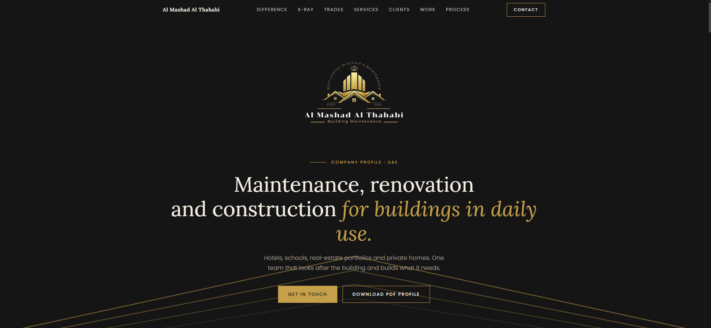

# almashad-building-maintenance
Responsive company website for a UAE building maintenance, renovation and construction firm, with interactive 3D trade models built in pure CSS (no libraries).

# Al Mashad Al Thahabi, Company Website

Single-page website for a UAE building maintenance, renovation and construction company.

**Live site:** https://shayanhussain-kazmi.github.io/almashad-building-maintenance/

## Features
- Interactive 3D villa with night mode and X-ray, built with CSS 3D transforms
- 3D trades section: waterproofing, sandwich panels, wiring, plumbing, ducting, painting, masonry, demolition
- Clients section with sector filter, services explorer, before/after slider, gallery lightbox
- Fully responsive, no frameworks or libraries, one HTML file

## Tech
HTML, CSS (3D transforms, custom properties), vanilla JavaScript

## Run locally
Open `index.html` in a browser.

## Author
Shayan Hussain, [LinkedIn](https://www.linkedin.com/in/shayan-hussain51214/) · [GitHub](https://github.com/shayanhussain-kazmi)
